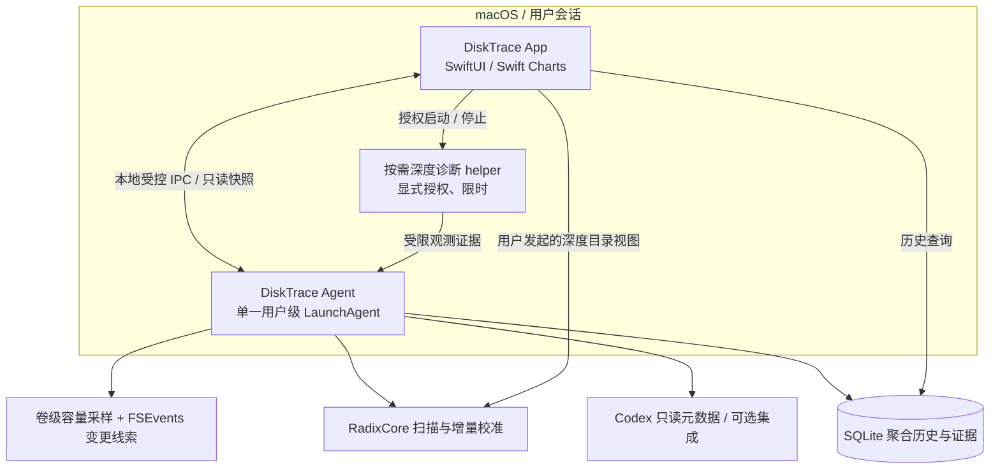

# DiskTrace — 技术架构精简与开源复用审查 v4.0

**状态：架构建议 / 开发前交接；未开始编码。**  
**审查日期：2026-10-12（美西时间）**  
**适用产品规格：DiskTrace PRD v3.2 与 Q1–Q31 决策，附加 AI-Agent 优先告警与预期用户操作过滤。**

> 一句话工程原则：**在现成扫描器上增加一条轻量的「空间变化 → 证据关联 → 告警判定」管线；后台只维护必要的聚合信息，重量级目录树和可视化按需加载。**

## 0. 执行摘要：决定删掉什么

此前草案的问题不是技术选型错误，而是以“完整通用磁盘产品”拆出了过多独立引擎。既然已确定首版重点是 Codex、Claude Code 等 Agent 自主任务带来的异常增长，而日常用户下载与复制默认不打扰，架构应相应收缩。

| 旧设想 | 最终处置 | 理由 |
|---|---|---|
| 独立 `Snapshot Engine` + 独立 `Event Collector` + `Investigation Engine` | **整合为单个 `MonitorCoordinator`**，内部调用扫描和事件适配器 | 没必要制造三套调度、重试和错误恢复逻辑 |
| Radix 扫描器 + OpenDisk 扫描器同时集成 | **不做**；先只接入 RadixCore 扫描链 | 双文件树、缓存、索引及 APFS 口径极难保证一致 |
| 长期保存每次完整文件树快照 | **不做**；持久化聚合变化与有限检查点，深度树图按需计算 | 满足历史趋势即可，大幅降低 I/O、内存与配额压力 |
| 每次 FSEvents 变更都立即递归扫描 | **不做**；合并路径、去抖、限速、批量校准 | 高频 node_modules/build 输出会击穿 Q12 性能目标 |
| 独立 `Investigation Engine` | **移除**；异常触发 `MonitorCoordinator` 有界补扫任务 | 和扫描调度、健康度状态高度重合 |
| 常驻全盘进程 syscall 记录 / fs_usage | **不做**；可选限时诊断会话 | 需要高权限、噪音高、不完整且不适合长期运行 |
| 引入 agentflash 的 Go、HTTP、WebSocket 和浏览器 UI | **不做**；只参考关联模型与 Hooks 配置策略 | 现有 SwiftUI 已足够，混合运行时重复造轮子 |
| 单独的“AI 用户意图识别模型” | **不做**；确定性规则 + 显式用户反馈 + unknown | 文件系统不能可靠知道谁点击了下载按钮；ML 无训练真值，误报难解释 |
| 全局默认自动识别 Finder/Chrome 预期操作并全部静默 | **降低承诺**；只静默有证据的行为或用户配置的规则 | 文件位置、进程名、时间相近都不足以证明人的主动意图 |
| 多个守护进程/单独 watchdog | **不做**；一个用户级 Agent，利用 launchd + 健康状态 + 有界恢复 | 符合 <50 MB 常驻目标 |
| 为时间线从零写图形引擎 | **不做**；用 Swift Charts / SwiftUI；深度磁盘图沿用 Radix | 降低实现成本与依赖数 |
| 自建更新系统 | **不做**；复用成熟更新方案，评估 Sparkle 与签名流程 | Radix 已有 Sparkle 实践；无需另写下载与校验逻辑 |

**结论：保留 1 个驻留 Agent、1 个 UI 应用、1 个 SQLite 数据库，以及少数可以单独测试的适配器。** “扫描”“归因”“提醒”仍保留逻辑接口，但不是分别启动的进程或复杂的微服务。

## 1. 本轮源码审查范围与证据等级

本轮通过 GitHub API 读取三个仓库的递归源码树，并抓取关键实际源码；未在真实 macOS 上编译、运行或测量性能。审查依据是以下固定树 SHA（**复用时还必须锁定精确 commit 并核验 SHA 对应分支提交**）：

| 仓库 | 读取到的 tree SHA | 实际查看内容 | 初步决定 |
|---|---|---|---|
| [Radix](https://github.com/colinvkim/Radix) | `df1235bfb05acb7a678718166491bcc27817d95d` | `Package.swift`、`IncrementalScanService.swift`、`FileSystemEventHistory.swift`、`ScanEngine.swift`、`FileTreeStore.swift`、README、完整路径树 | **首选扫描与深度可视化来源** |
| [OpenDisk](https://github.com/137137137/OpenDisk) | `f7551cf21a5c35a963c607401ba5705ec0869b64` | `ScanCache.swift`、`IncrementalUpdater.swift`、`FSEventsChangeJournal.swift`、README、完整路径树 | **算法/性能对照，默认不移植** |
| [agentflash](https://github.com/sjzasada/agentflash) | `d8c905b2787c218ec43c077b2a01974136171731` | `internal/tap/tap_darwin.go`、`internal/ui/claudehook.go`、README、完整路径树 | **借鉴事件模型，不引入 Go 服务** |

审查深度说明：这不是完整的逐行安全审计，尚未查看所有文件的完整调用图、测试覆盖率及实际依赖许可证。下文涉及内存、吞吐、macOS API 及权限的判定均为**设计推断或验证任务**，不是实测结论。上述 SHA 是 Git tree 对象的标识，不能直接当成已经确认的 commit ID。

### 1.1 Radix：最能减少重复造轮子的部分

公开 `Package.swift` 已存在独立 `RadixCore` library target，最低部署版本 `macOS 14.0`，Swift tools 6.2；包核心没有额外 Swift package 依赖，完整 App 使用 Sparkle。该包并非“只包含扫描器”，还包括扫描相关模型、增量策略、快照档案、APFS 分配处理以及部分协调、图形几何和 UI 相关逻辑。这意味着：

1. **先尝试直接依赖上游 `RadixCore` 的稳定可见接口**，而不是先复制几十个 Swift 文件。包存在不代表所有需要的类型都 `public`；如访问受限，优先评估最小适配层、独立 vendor copy 或向上游贡献接口，而非马上重写扫描器。
2. `IncrementalScanService.swift` 明确使用 **FSEvents checkpoint → 事件历史 → 增量扫描计划 → 子树重列/替换 → 提交一致的新快照**。当检查点不合格、事件历史不可用时回退完整扫描，且不提前发布半成品子树。DiskTrace 不应再创造另一套 checkpoint + incremental rescan 算法。
3. `FileSystemEventHistory.swift` 检查卷 UUID、事件 ID 范围与事件流可用性；可用于休眠或 Agent 重启后的补扫判断。**但 Radix 的按需历史查询不等于常驻 live watcher**：后者是否可以简单依靠周期重放替代，需要按 1 分钟发现目标实测。
4. `FileTreeStore`、`ScanSnapshot` 适合单次深度扫描的内存结构，**不要在低于 50MB 的常驻 Agent 中永久保存整棵全盘树**。保留粗粒度聚合索引在 SQLite；用户展开某个区间或目录时才运行高成本扫描及加载详细视图。
5. Radix 已有 `SunburstGeometry`、`TreemapGeometry`、文件浏览/安全移入废纸篓模块。深度视图优先复用；**历史时间曲线**直接用 Swift Charts，不需要再写 chart layout engine。

**风险**：当前 RadixCore 的 `Package.swift` 使用 `.defaultIsolation(MainActor.self)`，且原应用协调层大量围绕 `AppModel` 组织。虽然关键扫描服务采用 `nonisolated`、actor 和异步事件流，仍需真正验证可否在独立无 UI 的 LaunchAgent 中编译和运行；不能把整个 RadixCore 的内存开销等同于 Agent 常驻占用。Swift 6.2/Xcode 26 工具链要求也必须纳入构建环境。

**复用优先级**：`ScanEngine` / `IncrementalScanService` / `FileSystemEventHistory` / 快照与树模型 / APFS 统计 / 可视化几何；只有用户打开深度详情时才初始化重量级对象。`AppModel`、Workspace、大部分原产品导航和 Onboarding 不要直接复用。

### 1.2 OpenDisk：不建议同时接入

源码树包含 `TraversalScanner.swift`、`CatalogScanner.swift`、`ScanCache.swift`、`IncrementalUpdater.swift` 和 `SystemInterop/FSEventsChangeJournal.swift`。README 明确其使用 `getattrlistbulk(2)`、`searchfs(2)`、固定数量并发 worker、跨挂载点处理。

`FSEventsChangeJournal.swift` 对历史结束、内核/用户丢事件、根目录变动、MustScanSubDirs 和过多事件作出保守回退；这与 Radix 的防错策略大幅重合。`ScanCache.swift` 还维护自己的持久化扫描缓存和限制，若与 DiskTrace 的 SQLite 配额并存，会产生第二套存储生命周期。

**正确用法**：作为 baseline benchmark，对相同文件集合比较耗时、峰值 RSS、APFS 克隆及 hard link 口径。只有 Radix 在用户机器上的实测显著不符合预算，而且 OpenDisk 明显改善时，才采用**替换**扫描后端，而不是二者同时运行。替换前先统一 `ScanResult` 和 `SpaceAccounting` 类型，并补齐回归测试。

### 1.3 agentflash：复用概念，不复用 Go 栈

实际源码 `tap_darwin.go` 启动 `fs_usage -w -f filesys` 并逐行解析结果，按目录过滤后输出 NDJSON。README 明确 sudo 权限、SIP/hardened runtime、长路径截断和进程解析限制；这不足以为长期默认模式提供可靠的逐进程字节归因。

`claudehook.go` 读取 `session_id`、`cwd`、tool 信息，还可能读取 `prompt`、`command`、`message`。DiskTrace 不应复制这些原始 payload 的存储行为；只保留白名单字段和事件时间/会话标识（必要时哈希），不保存用户提示词、命令原文、文件内容或敏感文本。

**推荐**：若未来增加 Claude Code 官方 Hooks 适配，参考 agentflash 的幂等 merge / 保留无关配置 / cwd 作用域检查，但重新以最小 Swift helper 实现。**不引入 Go runtime、HTTP 服务、WebSocket 或浏览器界面。**

## 2. 优化后的最小部署架构



**部署选择**：

- **一个无特权用户级 Agent**：卷级容量采样、路径事件合并、增量扫描调度、聚合写入、Agent 会话证据索引、策略判定、macOS 通知。关闭窗口不停止 Agent。
- **一个独立 SwiftUI App**：时间线、事件筛选、解释证据、详细目录树、监控健康度、设置、手动文件定位/移入废纸篓。UI 不应无条件随登录常驻；可提供可选菜单栏入口。
- **一个 SQLite store**：原始事实和聚合结果共用事务与保留策略。Agent 为唯一写入方；UI 用只读连接或 IPC 快照查询，防止双写破坏一致性。
- **一个可选、按需启动的深度追踪 helper**：如果可行且授权，限定目录、期限和资源预算；若不具备实际权限或无法可靠取到进程，则明确降级，不允许作为基础功能阻塞条件。
- **不做云端账户、不做常驻网络服务、不做独立自愈守护进程。**

优先使用 macOS 原生 `SMAppService` 注册 app-bundled user LaunchAgent/Login Item（macOS 13+ 可用），不要默认通过安装脚本直接写 launchd plist。IPC 推荐 XPC（必要时简单 App Group 只读共享存储 + 受控 commands），避免为本机组件引入 HTTP 端口。

**关键决策：后台常驻内存目标与 Radix 扫描树冲突时，低内存优先。** 允许短暂启动单独扫描工作进程来隔离峰值 RSS，扫描结束即退出；但不应在性能测试之前提前加入第二个常驻进程。优先尝试单 Agent 中局部释放扫描对象、流式归档、分批目录处理，再根据峰值和内存回收情况决定是否额外隔离。

## 3. 数据处理路径：将“事实”与“推测”真正分离

### 3.1 三类数据，不要三套独立服务

```text
VolumeSample      = (volume_id, timestamp, free_bytes, capacity_bytes, availability_status)
DirectoryDelta    = (scan_window, normalized_path_id, delta_allocated_bytes,
                     before/after, checkpoint_id, calibration_status)
ChangeHint        = (event_id, path_id, flag, observed_at, source=FSEvents)
Evidence          = (event_or_delta_id, source_type, identity, observed_at,
                     scope, limitation, evidence_strength)
AlertDecision     = (rule_version, subject, action, reason, evidence_ids,
                     cooldown_key, evaluated_at)
CoverageGap       = (start, end, cause, affected_roots, severity)
```

注意分清：

- **可用空间减少（卷级）**、**受监控目录净增长**、**写盘 I/O 字节数** 是不同指标，不能强行对账成同一个数。
- `FileSystemEventHistory` 提供变动路径提示，不提供文件写入进程或准确写入字节。
- APFS clone、hard link、快照、可清除空间和跨卷移动会影响“释放/占用空间”与目录统计的对应关系。
- 目录路径本身只是归属线索；`~/.cache` 或 `node_modules` 不能证明某个 Agent 创建了它。

### 3.2 默认监控算法

1. Agent 启动，立即采样卷级容量；记录最近有效 checkpoint 与是否存在恢复缺口。
2. 使用极低成本的卷级容量轮询（初始目标 30–60 秒）以及 FSEvents 事件线索；首次运行渐进建立热点目录基线。
3. 对 FSEvents 命中的目录去重、向上合并、时间去抖。**只对候选变化区域调用 Radix 增量复扫**；事件过多、身份变化或历史不可靠时按资源预算进行渐进完整校准。
4. 先落库 `VolumeSample` 与事件窗口，再异步附加 `DirectoryDelta`、`Evidence`。不确定时展示 `pending` / `unexplained`。
5. 如果卷级剩余空间快速降低、某 Agent 相关目录异常增加或覆盖率下降，调度器进入有限增强模式；有最大持续时长、CPU/内存限流和冷却。
6. 归因与告警可延后，不得阻塞容量采样。异常时可以先记录中性的容量变化，归因完成后再评估是否需要 Agent 提醒。
7. 休眠/崩溃后恢复可用事件历史并做限量校准；不能还原的历史保留 `CoverageGap`。

**进一步删减**：首版无需默认对所有文件写入都持久化 `ChangeHint`；可以只持久化用于异常解释的去重变化窗口以及 checkpoint。高频原始事件进小容量有界内存队列或临时环形缓冲，避免“监控日志把磁盘占满”。

### 3.3 用户操作过滤的现实边界

DiskTrace **没有一个通用可靠的系统 API**，能够断言“这次空间增加是用户手动点击下载/复制，还是 Agent 自主发起”。因此 **默认静默普通变化** 与 **已确认是人的操作** 必须分开表述。

建议告警决策表：

| 证据组合 | 分类 | 默认动作 |
|---|---|---|
| 可靠的 Agent Hook/会话关联 + 可观测路径变化 + 阈值达标 | `agent_probable` 或在有直接进程证据时 `agent_confirmed` | Agent 告警 |
| 仅与 Agent 运行时间重叠 | `unknown` | 静默，但进入时间线待查 |
| 用户显式标记该次增长为预期行为 / 明确用户配置规则匹配 | `user_confirmed`（仅对于反馈/规则的范围） | 静默 |
| Finder/浏览器相关进程 + 合理的时间/目录线索 | `user_probable` | 默认静默，显示理由及可纠错选项 |
| 只有缓存目录命中，缺乏进程/任务证据 | `unknown` 或目录归属线索 | 静默；不可发“Codex 导致”告警 |
| 剩余空间触及危险线 | 单独的 `low_space_safety` | 中性安全告警，无论上述分类 |

**重要产品取舍**：为了低误报，首版宁可漏掉证据不足的 Agent 增长，也不要将普通下载误报为 Agent。对未知变化可以在 UI 中提示“值得调查”，并让用户选择后续持续关注，但不做主动指控。

过滤器采取纯函数判定：`AlertDecision = evaluate(StorageObservation, Evidence[], UserRules, PolicyVersion)`。用户规则有作用域、到期时间、撤销入口、解释文本和策略版本。**过滤只决定通知，不删除观测历史。**

### 3.4 Agent 关联：避免虚假的字节归因

首版 Codex 来源分为三种能力：

- **只读基线**：在用户许可的 Codex 本地状态中读取非内容性的会话 ID（可哈希）、时间、工作目录、可能的客户端信息；不可假设所有版本的格式稳定，也不能读取、保存会话正文。路径可能敏感，数据库权限和导出脱敏都要覆盖它。
- **可选官方事件集成**：只有验证当前所用 Codex 客户端实际支持 Hooks/通知才启用，使用最小追加式配置并可逆；已有 `notify` 机制的公开源码确认可在某些情形下提供回合完成事件，**但不代表 CLI、IDE、桌面 App 都覆盖**；且通知机制演进中，不应直接写死为唯一 API。
- **证据合并**：时间窗口、工作目录与文件变化仅能形成相关性；只有真实进程级文件操作证据，且路径匹配，才可以声称“观测到某进程操作此文件”。**不要直接把目录 5GB 净增长全部记在该进程名下。**

Claude Code 作为下一适配器利用官方 Hooks，沿用同一个精简 `AgentActivity` 事件结构。若首版 Codex 任务接口不够稳定，则首版至少真实实现一种可用的 Codex 集成方式，并明确仅在哪种客户端有效；不能为了“功能达标”捏造任务归因。

## 4. 性能与容量预算：把指标转换为设计约束

Q12：后台稳定空闲 **CPU 平均 <0.5%，常驻 Agent 内存 <50MB** 是实测目标，不是扫描峰值硬上限。

| 情形 | 行为 | 验证方法 |
|---|---|---|
| 空闲 30 分钟 | 只记录卷级采样、极少事件工作 | `powermetrics` / `top` / Activity Monitor，记录机器型号、OS、采样窗口 |
| Agent 写入大量小文件 | FSEvents 合并 + 有界重扫 | 记录队列最大长度、事件丢失、RSS、扫描延迟 |
| 深度视图打开 | UI 按需加载 Radix 文件树 | UI 进程与 Agent 内存分开统计 |
| Agent 异常增长 | 限时增强（用户授权才启用进程深追） | 记录触发、超时恢复、通知去重 |
| 休眠/重启 | 以 checkpoint 恢复并分批补扫 | 比较恢复前后卷级变化、Gap 状态 |
| SQLite 达配额 | 聚合旧事件、删临时/可重建数据；必要时暂停细节 | 将 db、-wal、-shm、快照、临时文件全部纳入统计 |

默认参数（**可配置且须测量修订**）：卷级采样 60 秒；详细证据 7 天，小时摘要 90 天，远期日摘要；历史存储软配额 1GB。**按需扫描优先级**可由近期变动频率及 AI 工具活跃路径确定，但不能因此忽略其他目录的卷级异常。

避免在 Agent 中缓存几十万 `FileNodeRecord`；若 Radix API 必须一次性返回大树，建议将扫描作为短生命周期工作任务并释放引用，必要时另设**非常驻**扫描 helper。严禁为了“模块漂亮”增加多个常驻服务。

## 5. 持久化与数据生命周期

使用 SQLite（WAL、明确 schema migration、单写入方、事务更新），按访问模式而非理论最细粒度拆表。建议只建立：

- `volume_samples`：卷级时间序列，可按小时/天聚合；
- `directory_changes`：窗口化目录净变化与扫描口径；
- `agent_activities`：会话/任务稀疏事件（最小元数据）；
- `evidence`：归因证据、来源类型与限制；
- `alert_decisions`：已告警/已抑制及规则版本；
- `monitor_state`：checkpoint、监控覆盖、校准时间、版本；
- `coverage_gaps`：中断/丢失/权限缺口；
- `user_rules`：显式反馈及静默策略。

这是逻辑 schema，并非必须八张独立表；Codex 可以按实际查询与迁移复杂度合并。常用索引为 `(volume_id, observed_at)`、`(path_id, window_end)`、`(agent_session_id, observed_at)`。路径索引要处理规范化、大小写与 APFS data volume firmlink；不存储文件正文。对路径、命令行和日志实行白名单与脱敏策略，不把全部 hook payload 入库。

数据汇总要具备幂等性：先写聚合再删除细节，在事务内标记汇总进度；SQLite 损坏时不直接重建覆盖旧库，先隔离/备份并展示降级状态。容量预算覆盖额外文件而非仅 `.sqlite`。

## 6. UI 设计：减少重写

**首页必须是时间线**（Q8），但无需复杂 Canvas：

- Swift Charts：卷级剩余空间曲线、最近异常窗口、增长 Top N；点击时间区间触发 SQLite 聚合查询。
- `EventDetailsView`：列出目录净增长、推测来源、进程/任务证据、信息缺口、被过滤的告警规则以及用户纠错选项。
- `HealthView`：Agent 运行状态、最近容量采样、最近校准、权限覆盖、事件缺口、数据库预算。
- `DeepDiveView`：用户主动选择目录后，以 Radix 扫描与布局代码呈现 sunburst/treemap；Finder Reveal / 手动移入废纸篓需独立防误删确认。
- Settings：通知阈值、监控范围、排除目录、数据期限、容量配额、Codex 集成开启/撤销、更新检查。

**不要移植 Radix 全部 Workspace / Sidebar / 新手教程 / 统计动效**。只引入需要的布局/格式化、权限提示和安全文件操作。第一版 UI 要清晰、可解释，而不是与 Radix 做功能竞赛。

## 7. 系统权限、分发和安全

1. 基础功能只使用用户可访问的目录与卷级容量 API；拒绝 Full Disk Access 时仍应有有限覆盖能力。**Full Disk Access 不赋予任意进程级监控的能力**。
2. 对深度进程观测单独建立 `ProcessTraceProvider` 可选接口；优先验证受支持、可合理分发的方案。`fs_usage` 解析可作为开发诊断/手动实验备选，不能假装它适合已公证、普通用户无痛安装的生产模块；Endpoint Security 受额外 entitlement 条件制约。
3. 使用 app-bundled 用户级 Agent + `SMAppService` 注册及卸载，不默认写入系统级 Daemon；只有用户确认后才注册/启动相应模块。
4. App 与 Agent 的 RPC/共享存储必须限制同用户权限和调用方身份。深度 helper 若涉及高权限，必须有独立签名校验、受限接口、停止与清理策略；权限不可扩大到无关路径。
5. 用户主动移入废纸篓：重新检查路径/权限/符号链接/文件变化，展示风险并要求确认；**不自动删除、不过度清理 Docker volumes 或运行中的数据库**。
6. 更新首选成熟框架（例如 Sparkle，需核实其单 app + bundled Agent 更新兼容与许可证），不自研 updater。用户同意后协调退出 Agent、保留数据并验证升级。
7. 发布通过 GitHub Releases + 签名/公证；Intel 与 Apple Silicon、macOS 14 起的实际设备/CI 测试单独验收。未经真实签名公证不写 `Release Ready`。

## 8. 工程组织：最小模块结构

```text
DiskTrace/
├── App/                         # SwiftUI 视图 + Swift Charts + 设置
├── Agent/                       # 用户级后台入口 + MonitorCoordinator
├── Shared/
│   ├── Models/                  # Observation, Evidence, AlertDecision, CoverageGap
│   ├── Storage/                 # SQLite schema、聚合、Retention
│   ├── Policy/                  # 纯函数通知判定 + 用户反馈规则
│   └── IPC/                     # 版本化请求/响应协议
├── Integrations/
│   ├── Scanner/                 # RadixCore 的薄适配层
│   ├── Codex/                   # 只读元数据 + 可选受支持事件
│   └── ProcessTrace/            # 非常驻按需深度诊断
├── Tests/                       # 单元、集成、系统可运行 fixture
├── Scripts/                     # macOS 真机测试/基准/安装卸载检查
├── THIRD_PARTY_NOTICES.md
└── docs/
    ├── ARCHITECTURE.md
    ├── TEST_MATRIX.md
    └── LIMITATIONS.md
```

不强制每个文件夹成为 Swift Package。只有真正跨 App/Agent 的模型或可单独编译的组件才提取为 target。所有内部接口以测试和复用收益为准，拒绝抽象为“插件平台”的无必要工作。

## 9. 开发前技术闸门：先验证，后确定实现方式

Codex 一次性交付可以保留，但必须按以下顺序在同一个任务内验证（不是拆成四个 PR）：

| 闸门 | 证明标准 | 决策变化 |
|---|---|---|
| G1：RadixCore 无 UI 使用 | 在 macOS 14+ 的命令行 target 中扫描一个 fixture；无 SwiftUI AppModel 注入 | 成功则直接依赖；失败则最小 vendor/接口拆解 |
| G2：内存释放 | 扫描大量小文件后 RSS 能回落；后台可维持 <50MB 目标 | 不行则隔离为**按需**扫描 worker |
| G3：FSEvents + 增量结果正确性 | 新增、删除、rename、硬链接、APFS clone、事件缺失比较与完整扫描一致 | 不行则保守 full rescan、记录缺口 |
| G4：Codex 真实事件支持范围 | CLI / Desktop / IDE 分别验证会话、时间、cwd、hook 是否可用 | 只承诺已验证客户端，未验证标记限制 |
| G5：进程级观测可分发性 | 权限路径、用户交互、签名/公证、路径/PID 实测 | 失败则功能标为待验证，**不虚构实现**；不得用时间重叠冒充进程证据 |
| G6：静默规则准确性 | Finder 拷贝、浏览器下载、Codex 写盘及并发活动测试 | 误报时收紧“Agent 告警”阈值与证据要求 |
| G7：软件更新、Agent 升级 | 安装、关闭 UI、重启、更新、卸载均保留历史与正常状态 | 不通过不得 Release Ready |

**当 G5 尚未解决**：可以交付工程完整的基础监控、扫描与 Codex 关联功能及深度接口，但必须把深度进程追踪标为 `NOT VERIFIED / NOT SHIPPABLE`；因为 Q20 选择了首版包含真实进程级追踪，不能把欠缺该能力的版本称为完整满足首版验收。用户已选择 Q31：工程交付与正式发布验收分开。

## 10. 核心测试矩阵

1. **普通操作静默**：用户下载 / Finder 复制大文件，卷级和目录变化可见，但无“Agent 自主操作”告警；无直接人类证据时仅表示 `not_agent_verified`，不标成 `user_confirmed`。
2. **Agent 自主增长**：确认的 Codex 活动（当前客户端可支持）关联明确文件变化；达到阈值应告警并说明“观察与推断”边界。
3. **并发写盘**：同窗口普通下载 + Codex 包安装，绝不把全部净增长记到 Codex。
4. **时序/归因失败**：只有时间重叠、命中 `node_modules` 或 `~/.cache` 时，不得标记 `agent_confirmed`。
5. **文件大小/容量口径**：逻辑大小、分配大小、卷级可用空间、clone/hard link 与 APFS 快照差异显示明确。
6. **极端事件压力**：10 万+ 小文件修改、rename 风暴、FSEvents overflow，Agent 有界队列、资源受控并标记缺口。
7. **中断/自愈**：sleep/wake、Agent SIGTERM、kill、权限改变、SQLite WAL 恢复；无静默历史覆盖。
8. **隐私**：Hooks 的 prompt、command、secret-like 字段不落磁盘，不进入日志/导出/截图；数据库权限安全。
9. **分发**：Intel/Apple Silicon、macOS 14+、SMAppService、签名公证、Sparkle 或同级 updater、完整卸载。
10. **性能**：30 分钟空闲 CPU/RSS 测量，重度活跃扫描的峰值独立报告；不符合 Q12 时保持 Engineering Complete 的风险清单，不宣称性能 PASS。

## 11. 当前真实风险与明确未完成项

| 事项 | 状态 | 处理 |
|---|---|---|
| RadixCore 是否直接可用作外部依赖 | **部分有据 / 未编译** | 包 target 已确认，public API、工具链与无 UI 构建待验证 |
| Radix 后台内存目标 | **未实测** | 严格将常驻 Agent 与 UI/Radix 大树的 RAM 分开 |
| OpenDisk 与 Radix 实测性能 | **未实测** | 只做基准，不先移植两套扫描系统 |
| Codex 所有客户端任务事件 | **不成立/未覆盖** | `notify` 机制不能视为全局事件总线，按客户端识别真实接口 |
| 已签名可分发的进程追踪 helper | **未验证** | 不承诺默认有权限、不静默提权 |
| 检测“主动下载/复制”的系统级确定性 | **不可保证** | 可解释的弱证据 + 用户反馈 + 低误报过滤 |
| 签名/公证、Universal 构建、稳定运行 | **未执行** | 实际真机 / 证书环境验收 |

## 12. 最终架构决策（ADR）

- **ADR-01**：独立 MIT 项目，不完整 Fork；先尝试以 Swift Package 复用 `RadixCore`，再考虑局部 vendor。
- **ADR-02**：只采用一个扫描后端。OpenDisk 是 benchmark 和算法备选，不与 Radix 同时集成。
- **ADR-03**：一个用户级 Agent + 一个 SwiftUI App + 一个 SQLite 存储；无默认 root daemon、Go 服务、HTTP 服务。
- **ADR-04**：文件系统事件是变化线索，目录扫描是容量校准，任务 Hook 是相关性证据；不可互相替代。
- **ADR-05**：通知策略与监控事实分离；未知与普通行为默认静默，严重低空间独立告警。
- **ADR-06**：深度诊断按需授权、限时运行；不把 `fs_usage` 当作生产级全覆盖保证。
- **ADR-07**：按需加载深度目录树，SQLite 存聚合历史；不要将 Radix 完整文件树长期保存在 Agent 内存。
- **ADR-08**：优先使用 SMAppService、SQLite、Swift Charts、成熟更新框架，避免自建系统能力。
- **ADR-09**：Engineering Complete 与 Release Ready 分离，任何未验证的进程归因和真机权限能力不得冒充已通过。

---

## 参考链接

- [Radix 仓库](https://github.com/colinvkim/Radix)、[Package.swift](https://github.com/colinvkim/Radix/blob/main/Package.swift)、[IncrementalScanService.swift](https://github.com/colinvkim/Radix/blob/main/Radix/Services/IncrementalScanService.swift)、[FileSystemEventHistory.swift](https://github.com/colinvkim/Radix/blob/main/Radix/Services/FileSystemEventHistory.swift)
- [OpenDisk 仓库](https://github.com/137137137/OpenDisk)、[FSEventsChangeJournal.swift](https://github.com/137137137/OpenDisk/blob/main/OpenDisk/Services/Scanning/SystemInterop/FSEventsChangeJournal.swift)、[ScanCache.swift](https://github.com/137137137/OpenDisk/blob/main/OpenDisk/Services/Scanning/ScanCache.swift)
- [agentflash 仓库](https://github.com/sjzasada/agentflash)、[tap_darwin.go](https://github.com/sjzasada/agentflash/blob/main/internal/tap/tap_darwin.go)、[claudehook.go](https://github.com/sjzasada/agentflash/blob/main/internal/ui/claudehook.go)
- [Apple SMAppService 官方文档](https://developer.apple.com/documentation/servicemanagement/smappservice)
- [Codex 配置源码中的 notify 注释](https://github.com/openai/codex/blob/main/codex-rs/core/src/config/mod.rs)、[notify 事件范围的讨论](https://github.com/openai/codex/issues/19921)、[桌面客户端行为报告](https://github.com/openai/codex/issues/13019)

**不开发声明**：本文仅重做架构、审查上游并给出可执行的设计与验证闸门；未创建 DiskTrace 源码仓库、未修改其他仓库。Codex Handoff v3.2 需要随后以本文件 ADR 为优先架构依据更新，不可直接照搬其旧的多引擎建议。
